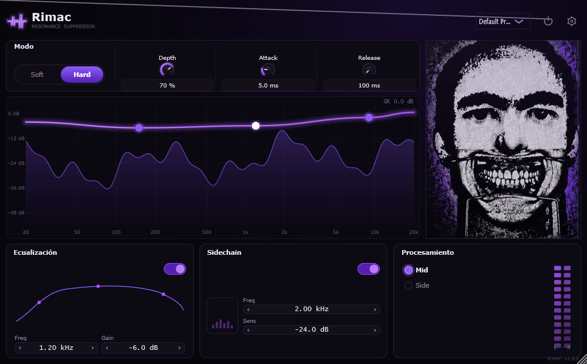

# Rimac — Resonance Suppressor

Plugin de audio (VST3 / AU / Standalone) que **suprime resonancias dinámicamente** en tiempo real sin alterar el timbre de la señal. Construido con JUCE 8 y CMake.



---

## Características

| # | Función | Cómo se implementa |
|---|---------|--------------------|
| 1 | **Supresión dinámica de resonancias** | STFT de 2048 puntos con 4× solapamiento. Se calcula la media espectral local (±22 bins) y los bins que sobresalen por encima del umbral se atenúan. Al ser un proceso multiplicativo sobre la magnitud, el timbre original se conserva. |
| 2 | **Modos Soft / Hard** | Soft: umbral alto (5 dB), pendiente suave (0.85), máximo 18 dB de corte. Hard: umbral bajo (1.5 dB), pendiente agresiva (1.75), hasta 30 dB, y reacciona más al nivel de entrada. |
| 3 | **Depth** | 0–100 %. Escala la cantidad total de supresión aplicada (profundidad del corte y velocidad de reacción). |
| 4 | **Nodos de ecualización y Sidechain** | La curva del gráfico enfoca la supresión en una banda (Freq + Gain, con ancho que se estrecha al bajar el gain). El sidechain tiene filtro paso-banda (Freq) y umbral de sensibilidad (Sens). |
| 5 | **Attack / Release** | Balística asimétrica sobre la curva de ganancia por bin, en ms. Attack 0.1–500 ms, Release 5–2000 ms. |
| 6 | **Procesamiento Mid/Side** | La señal se codifica a M/S al entrar; el STFT procesa el componente elegido (Mid o Side) y se decodifica al salir. Ambos componentes comparten la misma ventana temporal, así que no hay desalineación de fase. |

Extras: bypass con latencia reportada al host, 3 presets, medidor de salida, indicador de reducción (GR), UI redimensionable con aspecto fijo y tooltips.

El panel derecho muestra el retrato incrustado en el binario (`juce_add_binary_data`), así que el arte viaja con el plugin.

---

## Instalación

Descarga el ZIP desde **Actions → Build → Artifacts** y copia:

| Sistema | Destino |
|---------|---------|
| Windows | `C:\Program Files\Common Files\VST3\` |
| macOS | `~/Library/Audio/Plug-Ins/VST3/` y `~/Library/Audio/Plug-Ins/Components/` |
| Linux | `~/.vst3/` |

Reinicia el DAW. El plugin aparece como **Rimac** en la categoría *Dynamics*.

> El plugin reporta 1536 samples de latencia (`fftSize - hopSize`), que el host compensa automáticamente.

---

## Compilar

```bash
cmake -B build -DCMAKE_BUILD_TYPE=Release
cmake --build build --config Release --target Rimac_VST3
```

Requisitos: CMake ≥ 3.22, compilador C++17, y conexión a internet la primera vez (JUCE se descarga vía FetchContent).

Para el Standalone (útil para probar sin DAW):

```bash
cmake --build build --config Release --target Rimac_Standalone
```

---

## Cómo funciona el DSP

```
entrada L/R
   │
   ├─► codificación M/S  (M = (L+R)/2, S = (L−R)/2)
   │
   ├─► FIFO → STFT 2048 / hop 512, ventana Hann
   │        │
   │        ├─ magnitud en dB
   │        ├─ media local (±22 bins) = envolvente
   │        ├─ residual = magnitud − envolvente
   │        ├─ si residual > umbral → corte objetivo (Depth × pendiente × peso EQ)
   │        ├─ suavizado temporal (attack/release por hop)
   │        ├─ suavizado frecuencial (kernel 1-2-1) → curvas musicales, no notches
   │        └─ IFFT + overlap-add (WOLA)
   │
   └─► decodificación M/S → salida L/R
```

El detector de sidechain corre en paralelo: filtra la señal por la banda elegida, calcula el nivel y ajusta la sensibilidad del umbral de supresión. Si el sidechain está apagado, el detector usa la propia señal.

**Soft** se comporta como un *tamer* transparente; **Hard** como un *dynamic EQ* correctivo que se dispara con más fuerza cuanto más energía hay en la banda.

---

## Estructura

```
Source/
  PluginProcessor.*      parámetros APVTS, buses, latencia, presets
  PluginEditor.*         layout y dibujo de la interfaz
  dsp/SpectralSuppressor.*  motor STFT + M/S + sidechain
  ui/Theme.h             paleta y utilidades de dibujo
  ui/Knob.*              knobs, switches, pills y steppers
  ui/EQDisplay.*         espectro en vivo + curva editable por nodos
  ui/PortraitPanel.*     panel de arte (halftone)
```

---

## Licencia

MIT. JUCE se usa bajo su licencia dual (AGPLv3 / comercial); revisa los términos antes de distribuir un binario.
